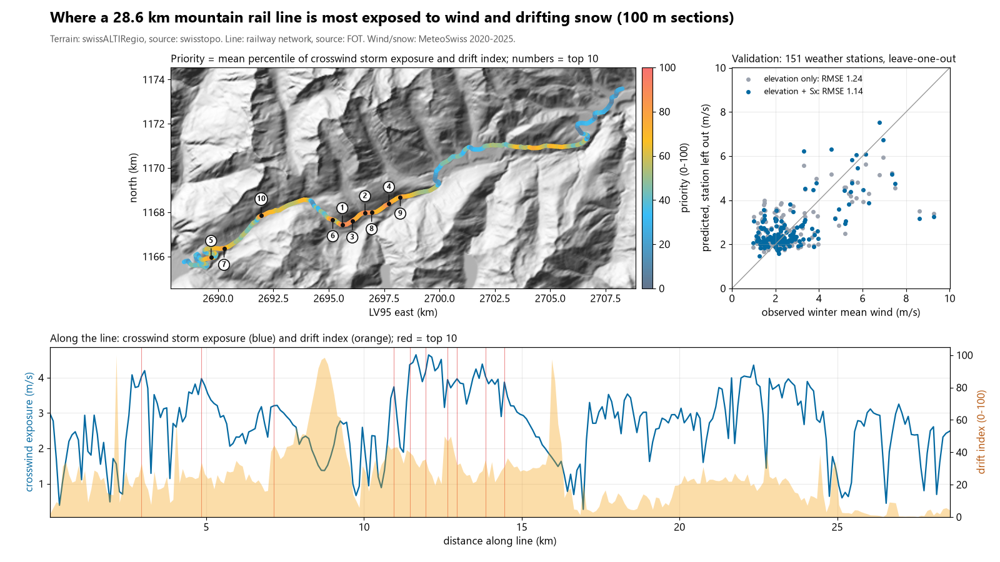
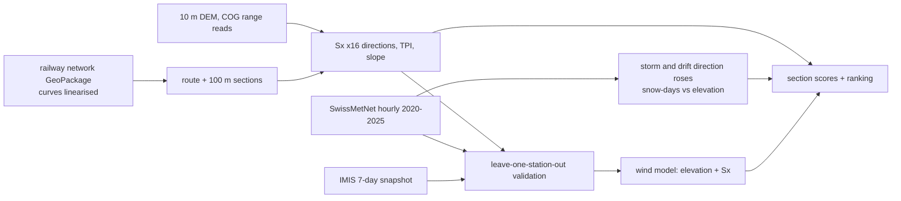

# alpine-line-exposure-map

Rank every 100 m of a mountain rail, road or ropeway line by terrain exposure to storm wind and drifting snow, so a maintainer knows where sensors, snow fences or watch posts go first, with the terrain index checked against 151 weather stations it was not fitted on.



## What it does

- Takes a line as a polyline (here: a 28.6 km metre-gauge mountain rail line over an Alpine pass at about 2,040 m in central Switzerland, routed through the federal railway network data) and cuts it into 100 m sections.
- For each section, computes terrain exposure from a 10 m DEM: the upwind maximum-slope index **Sx** (Winstral et al. 2002) for 16 wind directions and 3 search distances (100, 300, 1000 m), plus elevation, slope and topographic position (TPI).
- Weights the directions with the storm-wind and drifting-snow climatology of the nearest crest weather station (hourly data 2020-2025).
- Scores each section for **crosswind storm exposure** (m/s) and a **drift index** (0-100), ranks them, merges hot stretches, and flags sections where the DEM grade is impossible for a railway (likely tunnel, gallery or cutting).
- **Validates** the terrain index: does it explain observed wind at stations left out of the fit, better than elevation alone?

## Results

All numbers come from `python -m alpine_line_exposure demo` on the committed derived data (see `results/`).

**Validation, leave-one-station-out** (storm-direction weights and regression refitted without the held-out station):

| Station set (target) | n | elevation only, RMSE | elevation + Sx 300 m, RMSE | change | 95 % CI of RMSE diff |
|---|---|---|---|---|---|
| SwissMetNet, winter mean wind, Nov-Apr 2020-2025 | 151 | 1.24 m/s | 1.14 m/s | **-8.0 %** | -0.18 to -0.03 m/s |
| SwissMetNet, winter 95th pct hourly gust | 151 | 3.60 m/s | 3.22 m/s | -10.6 % | -0.65 to -0.13 m/s |
| SwissMetNet, stations >= 1000 m only | 60 | 1.70 m/s | 1.61 m/s | -5.2 % | -0.20 to +0.01 m/s (not significant) |
| IMIS, 7-day mean wind, 2026-11-04 to 2026-11-11 | 200 | 1.40 m/s | 1.18 m/s | -15.2 % | -0.32 to -0.11 m/s |

- Rank correlation (Spearman) of LOO prediction vs observed winter mean wind: 0.36 with elevation only, 0.47 with elevation + Sx. The Sx exposure correlates with what elevation leaves unexplained at rho = 0.46.
- **Honest caveats from the same runs:** a plain 500 m topographic position index does better than Sx (RMSE 1.02 m/s, -17.4 %), and Sx adds nothing on top of it (1.03 m/s, post-hoc model). Weighting Sx by the storm-direction climatology gave the same error as equal weights (1.138 vs 1.139 m/s): on this data the direction weighting is not shown to matter. 1000 m search distance did slightly better than 300 m (-9.8 %).
- Because of that, the line ranking is sensitive to the index: along the line, wind predictions from the Sx model and the TPI model correlate at rho = 0.48, and only 4 of the top-10 wind sections fall within 300 m of each other.

**The line** (286 sections of 100 m):

| | |
|---|---|
| Reference crest station, storm hours (top 10 % winter wind) | 54 % from SSE, 15 % from SE (foehn), 10 % from N |
| Heuristic drifting-snow hours at that station (snow >= 10 cm, T < 0 C, wind >= 8 m/s) | about 1,000 h per year |
| Snow >= 20 cm on 50 % of winter days at (logistic fit, 38 stations) | 1,575 m |
| Top priority stretch | km 11.3-12.2 (9 sections, elevation about 1,870 m, below the summit at km 9.8), then km 12.5-13.1 |
| Sections flagged by DEM grade > 15 % (probably tunnel, gallery or cutting) | 13 |

Top-10 lists are in `results/top_priority.csv`, `results/top_wind.csv`, `results/top_drift.csv`; every section in `results/sections_ranked.csv`; stretches in `results/hotspots.csv`.

## Quick start

```bash
uv venv .venv --python 3.12
uv pip install --python .venv/Scripts/python.exe -e ".[dev]"     # Linux/macOS: .venv/bin/python
.venv/Scripts/python.exe -m alpine_line_exposure demo             # offline: validation, ranking, figures (about 1 min)
.venv/Scripts/python.exe -m pytest -q -p no:asyncio
```

Rebuild the derived tables from the open sources (network; about 1 GB streamed, about 100 MB cached in `cache/`):

```bash
uv pip install --python .venv/Scripts/python.exe -e ".[fetch]"   # adds rasterio for the DEM
.venv/Scripts/python.exe -m alpine_line_exposure build --start "Andermatt" --end "Disentis/Mustér" --section-m 100
```

`--start/--end` are node names in the federal railway network. For another corridor (road, ropeway), `line.read_polyline` reads a CSV (`e,n` in LV95 or `lat,lon`) or a GeoJSON LineString.

## How it works



- **Sx** at a point for wind from direction A: the steepest elevation angle to any terrain within `dmax` upwind, averaged over A +- 15 deg. Negative = exposed (ridge, convex slope), positive = sheltered (lee, hollow, cutting).
- **wind_score** = predicted winter mean wind (elevation + Sx, fitted on all stations) x share of storm-hour directions that cross the track (|sin| of the angle).
- **drift_index** = shelter angle where drifting-snow winds cross the line, boosted when the terrain 200 m upwind is exposed (a snow source), x share of winter days with >= 20 cm snow at that elevation; scaled 0-100. A heuristic: not validated.
- **priority** = mean percentile rank of the two.
- The GeoPackage reader handles curved geometries (CircularString, CompoundCurve, MultiCurve with M values) without GDAL.

## Data sources

- **Terrain:** swissALTIRegio 10 m digital terrain model, read as windows from the cloud-optimised GeoTIFF on data.geo.admin.ch. Source: Federal Office of Topography swisstopo. swisstopo free geodata (OGD) terms: use, processing, redistribution and commercial use allowed; the source reference is mandatory. `data/corridor_dem_50m.npz` is a derived 50 m block mean of the corridor, for the figure only.
- **Line geometry:** "Railway network" basic data set (`ch.bav.schienennetz`, state 2026-07-01). Source: Federal Office of Transport FOT. Licence: opendata.swiss "Open use. Must provide the source." `data/line.csv` holds the derived centreline coordinates only (no attributes).
- **Weather:** MeteoSwiss SwissMetNet automatic stations, hourly values (`ch.meteoschweiz.ogd-smn`, files `*_h_historical_2020-2029`, 2020-01-01 to 2025-12-31 UTC), licence CC BY 4.0. Source: MeteoSwiss. `data/stations_smn.csv` holds per-station statistics derived from them.
- **Alpine stations:** IMIS network, public measurement API (30-min values; the public API serves only the last 7 days, so this is a one-week snapshot: 2026-11-04 to 2026-11-11). Licence CC BY 4.0. Source: WSL Institute for Snow and Avalanche Research SLF (www.slf.ch); IMIS data DOI https://doi.org/10.16904/envidat.406. `data/stations_imis.csv` holds derived per-station statistics.
- OpenStreetMap is not used.

## What is not verified yet

- **No ground truth on the line itself:** no records of closures, wind-related slowdowns or snow drifts were available, so the ranking is not checked against what actually happens on the track.
- The drift index and the crosswind weighting are physically motivated heuristics, not validated. Existing protection (snow sheds, galleries, fences, tunnels) is not known to the model; 13 sections are flagged by the DEM grade test, others may be covered too.
- A simpler index (TPI 500 m) explained station wind better than Sx, and the storm-direction weighting did not improve the validation; the ranking changes noticeably with the index choice.
- 10 m DEM resolution: cuttings, embankments, buildings and forest are not resolved. Station coordinates are given to the metre, but a few tens of metres of offset can change Sx on a crest.
- The station network is sparse in the high Alps (60 SwissMetNet stations above 1000 m); the IMIS check is a single autumn week, not a climatology. The drifting-snow hours use a rule-of-thumb wind threshold.

## Licence

MIT, Copyright (c) 2026 Victor Bonilla. Data remain under their own terms (see Data sources).
